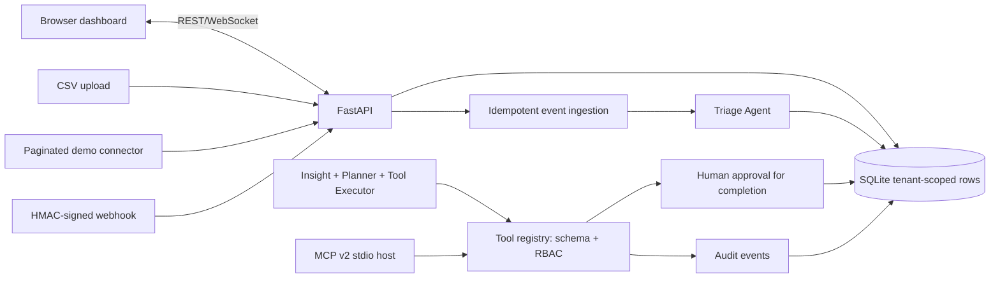

# Architecture, decisions and threats

## Context

The public target engineering profile calls for a spreadsheet-replacement product with multi-tenant foundations, event integrations, analytics and an MCP-compatible tool layer. OpsPilot uses an original, minimal implementation that can run locally without any third-party accounts.

## Trust boundaries

- The API key is accepted in `X-API-Key`, hashed at rest and used to look up `org_id`, `role` and the acting user name. The `org_id` comes **from the credential**, not a user-supplied body parameter.
- Every tenant read and mutation has an explicit `org_id` predicate. The cross-tenant tests exercise ordinary API calls and agent tools.
- Webhooks are intentionally unauthenticated by API key, but require a per-integration HMAC signature derived from a server secret and a stable event ID. Repeats do not create duplicate work items.
- User and connector text is **data**, never executed as commands or interpreted as a model instruction. Schema validation gates tools. Completions are queued for owner review.
- CSV export neutralizes common spreadsheet formula prefixes. HTML is escaped before insertion; browsers never receive API keys in URL query strings.
- Live WebSocket clients authenticate with their first message. The API key is not persisted to browser storage.
- Demo keys are public and strictly for LOCAL testing. Use TLS plus real identity for deployments. CORS is not permissively configured.

## Business flow: from event to task

1. Connector fetches a bounded page or signed webhook receives an external event.
2. The event uniqueness constraint `(org_id, integration_id, external_id)` enforces deduplication.
3. Triage Agent maps the event's title and severity to an open task.
4. Both the event and task are inserted in the **same transaction**.
5. Metrics and live WebSocket snapshots immediately reflect the new state.
6. `tasks.complete` always produces a pending approval; only an owner can approve it.
7. Every tool action, rejection, connector sync and triage event receives an audit record.

## Agent collaboration: exact semantics

- `TriageAgent`: deterministic `severity -> priority` policy during event ingestion; creates a task after a novel event.
- `InsightAgent`: returns measured open/urgent task counts for the caller's tenant.
- `PlannerAgent`: outputs a **two-step read-only** plan, regardless of wording of the natural-language objective; no arbitrary model-suggested action is executed.
- `Tool Executor`: invokes a small allowlisted registry with JSON Schema, role enforcement and approval gating.
- `MCPServer`: optional standalone stdio transport providing tool aliases that call the **same** registry. The MCP host must supply a valid tenant-scoped key via the process environment.

This is a safe base for adding an LLM. It is *not* yet a general-purpose reasoning agent. Future model proposals must pass exactly the same policy boundary.

## Storage decisions

SQLite is appropriate for a single local pilot. It is not a substitute for PostgreSQL RLS, tenant-aware partitioning, distributed locks, a task queue or migration tooling. Connector cursors are checkpointed after processed batches, updated monotonically, and duplicate events are uniquely constrained. Crash after writing an event but before checkpoint causes a harmless replay on next sync. Concurrent sync workers should additionally use per-connector leases in production.

## Next milestones

1. **Identity, SaaS foundation**: OIDC login, memberships, organizations, roles and fine-grained authorization; tenant-scoped Postgres repositories; Alembic migrations.
2. **True third-party integrations**: OAuth2 authorization-code + PKCE, state validation, encrypted refresh tokens, webhook signature validation per vendor, outbound allowlists, pagination, exponential backoff and provider-specific rate limits.
3. **Jobs**: durable queue, retries, dead-letter handling, leases for each connector, sync lag metrics and reconciliation.
4. **LLM agents**: structured reasoning/planning provider adapter, signed capability tokens, prompt-injection isolation, explicit write approvals, evaluation suites and per-tool cost/latency traces.
5. **Observability and pilot**: OpenTelemetry, structured logs, SLOs, automated backups, deploy rollback, end-to-end browser tests, load/security tests.
